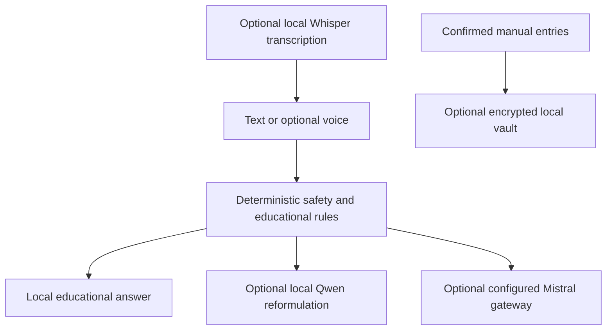

# DiabCare — JARVIS DT1 · Studio Niko Design

**Local-first educational voice companion · Optional on-device inference · Manual journal**

[Documentation technique](diabcare/README.md) · [Sécurité](SECURITY.md) · [Licence](LICENSE.md) · [English overview](#english-overview)

> Prototype documentaire non validé cliniquement. Aucun calcul de dose, contrôle de pompe ou suivi glycémique continu. Utiliser des données fictives pour les démonstrations.

## Architecture observée



| Source | Fonction constatée |
| --- | --- |
| [diabcare/core.mjs](diabcare/core.mjs) | Règles documentaires, filtrage prioritaire des demandes sensibles, journal manuel |
| [diabcare/model.mjs](diabcare/model.mjs) | Chargement wllama et appel createChatCompletion pour reformulation locale |
| [diabcare/speech-offline.mjs](diabcare/speech-offline.mjs) | Transformers.js, Whisper tiny, pipeline de transcription WASM |
| [diabcare/vault.mjs](diabcare/vault.mjs) | AES-256-GCM et PBKDF2-SHA256, 500 000 itérations |
| [api/diabcare-chat.mjs](api/diabcare-chat.mjs) | Relais Mistral optionnel avec configuration serveur et filtrage |

Les modèles locaux exigent un téléchargement initial et un navigateur compatible. La présence du code d'inférence ne prouve pas son exécution sur tous les appareils. L'empreinte de modèle documentée n'est pas une vérification obligatoire de chaque téléchargement. Le relais distant nécessite un consentement, une configuration serveur et une revue des données réellement transmises. La reconnaissance vocale réseau, lorsqu'elle est autorisée, est distincte de Whisper local.

## Documentation existante

PWA vocale spécialisée dans le diabète de type 1. L'application principale se trouve dans [diabcare/](./diabcare/) et possède une adresse GitHub Pages annoncée, non recontrôlée ici :

**https://nikoju1977.github.io/jarvisdiabete/diabcare/**

La racine du dépôt redirige vers cette application. L'ancien prototype intégrant de la synchronisation et des suggestions thérapeutiques a été retiré de l'interface principale. Ses anciens fichiers HTML ne sont plus servis comme application utilisateur. Les données stockées par l'ancienne version ne sont **pas migrées automatiquement** ; aucune suppression automatique des anciens coffres n'est effectuée.

## Fonctions

- JARVIS : commandes vocales sur activation, synthèse vocale, interface adaptée aux mobiles.
- GlucoCheck : lecture des glycémies *saisies*, avec horodatage ; dictée validée avant inscription au journal.
- Calculateur de glucides : portions explicites, sources Open Food Facts ou mini-référentiel indicatif hors connexion.
- Assistant pédagogique hors connexion ; Qwen GGUF optionnel selon compatibilité du navigateur.
- Mistral uniquement sur un serveur compatible, après accord explicite ; ce mode **n'est pas disponible depuis GitHub Pages statique**.
- Coffre local chiffré, sauvegarde et restauration.
- Filtrage prioritaire des demandes d'insuline : aucune recommandation de dose ni contrôle de pompe.

## Statut médical

Il s'agit d'un assistant documentaire personnel, non d'un dispositif médical certifié ni d'un système de surveillance continue. Aucune fiabilité médicale de 100 % n'est garantie. Les données manuelles ne permettent pas de prédire les hypoglycémies.

## Développement et tests

Les sources et limitations sont documentées dans [diabcare/README.md](./diabcare/README.md).

```bash
cd diabcare
node --test *.test.mjs ../api/diabcare-chat.test.mjs
```

Les tests automatiques ne remplacent ni les essais sur iPhone/Android ni une validation clinique.


## Qualification proposée

Avec des données entièrement fictives, vérifier les refus de demandes thérapeutiques, les états indisponibles des moteurs, la transcription et confirmation des entrées, le mode sans stockage, la restauration du coffre et les flux réseau. Les règles de sécurité ne couvrent pas tous les cas et ne constituent pas un triage médical fiable. Aucun nouveau test, appel fournisseur, téléchargement de modèle ou essai physique n'a été réalisé.

## English overview

DiabCare is an educational voice companion with a manual journal, deterministic safeguards, optional local Qwen and Whisper inference, an encrypted local vault and a separately configured Mistral gateway. It does not calculate insulin doses, control pumps or provide continuous glucose monitoring. Model availability, safety and device compatibility remain unverified in this revision. No new clinical, runtime or deployment validation was performed.

[Notice de droits](LICENSE.md) : droits réservés pour les contributions originales concernées ; les modèles et composants tiers conservent leurs droits.
